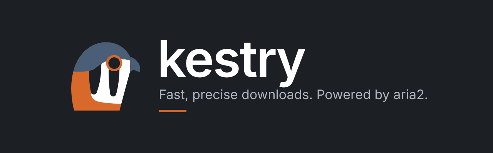

<p align="center">
  
</p>

# Kestry

[English](README.md) · Español

Gestor de descargas autoalojado para torrents, enlaces magnet y enlaces directos (HTTP/HTTPS/FTP). Funciona en un PC doméstico o un servidor, usa [aria2](https://aria2.github.io/) como motor de descarga y se maneja desde cualquier navegador con una interfaz en vivo y adaptable construida sobre el sistema de diseño *Kestrel*, que forma parte de este proyecto.

- Pega una lista entera de enlaces (uno por línea) y añádelos con un clic; también puedes soltar archivos `.torrent`.
- Varias descargas a la vez y el resto en cola; pausar, reanudar, reintentar, cancelar.
- Progreso, velocidad, tiempo restante y pares en vivo mediante Server-Sent Events.
- Límites de velocidad, concurrencia, carpeta de descarga, seeding y "apagar al terminar".
- Un proceso, un puerto. Sin base de datos. Sin login: protégelo con un túnel o una VPN (ver [Acceso remoto](#acceso-remoto-y-seguridad)).

- Disponible en inglés, español, alemán y francés. El idioma sigue al navegador y se puede cambiar desde el icono del globo en la cabecera (se recuerda en el navegador).

## Instalación

### Docker (recomendado)

```bash
cd docker
mkdir -p data downloads
sudo chown -R 1654:1654 data downloads   # la imagen se ejecuta con uid 1654; si no, aria2 falla con permission denied
docker compose up -d --build
```

Abre <http://localhost:8080>. El puerto se publica solo en `127.0.0.1`; para acceder desde otros dispositivos de tu red, pon en `KESTRY_BIND` de `docker/.env` la IP LAN del servidor (p. ej. `192.168.1.50`) y abre `http://192.168.1.50:8080`. No hay login, así que cualquiera en esa red puede usarlo; nunca redirijas el `8080` en el router. La imagen incluye aria2 y se ejecuta como usuario no root (usa `user:` en el compose para que coincida con el propietario de las carpetas montadas). Redirige el `6881` TCP/UDP en el router para mejorar la velocidad de BitTorrent.

### Binario (Windows / Linux)

Descarga el zip de tu plataforma desde la página de releases (o genéralo con `scripts/publish.sh`), descomprímelo y ejecuta `Kestry.Server` (`Kestry.Server.exe` en Windows). Mantén `wwwroot/` y `appsettings.json` junto al ejecutable. Después abre <http://127.0.0.1:8080>.

aria2 **nunca se incluye**:

| Plataforma | Qué ocurre |
|------------|------------|
| Windows | Si no encuentra `aria2c.exe`, Kestry descarga la release oficial fijada, verifica su SHA-256 y la extrae en `data/aria2/` (la UI muestra "Instalando aria2…"). Sin internet o con un hash incorrecto no se ejecuta nada; copia `aria2c.exe` a `data/aria2/` a mano o define `Aria2:Path`. |
| Linux | Instálalo con tu gestor de paquetes (`apt install aria2`, `dnf install aria2`…) o define `Aria2:Path`. Kestry muestra "aria2 no responde" con instrucciones hasta encontrarlo. |

Orden de búsqueda: `Aria2:Path` → `PATH` → `<DataDir>/aria2/`.

**Como servicio**: en Windows funciona `sc create Kestry binPath= "C:\ruta\Kestry.Server.exe"` (la app detecta el gestor de servicios). En Linux copia `deploy/kestry.service` a `/etc/systemd/system/`, ajusta rutas/usuario y ejecuta `systemctl enable --now kestry`.

### Desde el código fuente

Requiere .NET SDK 10 y Node 22.

```bash
cd src/kestry-web && npm ci && npm run build     # escribe src/Kestry.Server/wwwroot
cd ../.. && dotnet run --project src/Kestry.Server
```

## Configuración

`appsettings.json` junto al ejecutable, o variables de entorno (`Kestry__AllowedRoots__0=/downloads`, `Aria2__Port=6800`…).

| Clave | Por defecto | Significado |
|-------|-------------|-------------|
| `Urls` | `http://127.0.0.1:8080` | Dónde escucha Kestry. Solo loopback por defecto; la imagen Docker usa `http://+:8080` (y el compose lo publica en `127.0.0.1`). Defínelo con la variable `Urls`, no con `ASPNETCORE_URLS`. |
| `Kestry:DataDir` | `./data` (junto al ejecutable) | `settings.json`, `aria2.session`, `history.json` (descargas terminadas), binario de aria2 descargado |
| `Kestry:AllowedRoots` | `[]` (= `~/Downloads/Kestry`) | Las únicas carpetas donde puede estar la carpeta de descarga y donde se pueden borrar archivos. Docker define `/downloads`. No editable desde la UI. |
| `Kestry:AllowShutdown` | `true` | `false` desactiva por completo "apagar al terminar" |
| `Kestry:AllowedOrigins` | `[]` | Orígenes/hosts adicionales aceptados, p. ej. el de tu túnel `https://kestry.example.com` |
| `Aria2:Path` | `null` | Ruta explícita de `aria2c` |
| `Aria2:Port` | `6800` | Puerto RPC de aria2 (solo loopback, secreto aleatorio en cada arranque) |
| `Aria2:BtPort` | `6881` | Puerto BitTorrent + DHT (TCP/UDP) |
| `Aria2:ExtraArgs` | `[]` | Argumentos adicionales de línea de comandos para aria2 |

Los ajustes de usuario (concurrencia 1–20, límites de velocidad, carpeta de descarga, seeding, apagado) se editan en la UI (icono del engranaje) y se guardan en `settings.json`. Se aplican a las descargas en curso sin reiniciar aria2. La carpeta solo afecta a las descargas nuevas. El tema (claro/oscuro/sistema) se guarda en el navegador.

## Uso

- **Añadir**: pulsa *Añadir* o simplemente `Ctrl+V` en cualquier parte de la página fuera de un campo de texto. Separa los enlaces con saltos de línea, espacios o comas; las líneas que empiezan por `#` se ignoran. Un resumen en vivo muestra los enlaces válidos, duplicados e inválidos antes de añadir nada. Los duplicados se detectan dentro del lote y frente a las descargas existentes (por URL o info-hash del torrent).
- **Filas**: descargando → pausar/cancelar · en pausa → reanudar/cancelar · en cola → cancelar · fallida → reintentar/eliminar · completada → copiar ruta/eliminar. *Cancelar* borra los archivos parciales; *Eliminar* borra opcionalmente los archivos. Reintentar un torrent lo vuelve a añadir desde su magnet.
- **Apagar al terminar**: se activa cuando la cola está vacía y al menos una descarga se completó en esta sesión (las descargas en pausa y los torrents en seeding cuentan como pendientes). Se muestra una cuenta atrás de 60 s en todos los navegadores abiertos y se puede cancelar. En Linux el usuario del servicio necesita permiso para apagar: instala `deploy/50-kestry-poweroff.rules` como regla de polkit (ajusta el usuario). No está disponible en contenedores ni cuando `AllowShutdown` es `false`.

## Acceso remoto y seguridad

Kestry **no tiene autenticación a propósito**; protégelo en la capa de red. Por defecto solo escucha en loopback, y aria2 nunca se expone (loopback + secreto RPC aleatorio). Además, toda petición a `/api` debe venir de un host loopback/IP/`AllowedOrigins` (evita DNS rebinding), y las peticiones que modifican estado desde un navegador deben llevar el `Origin` de la propia página o uno permitido (evita peticiones cross-site). Los cambios de carpeta y el borrado de archivos están limitados a `AllowedRoots`; el tamaño de los cuerpos de petición está limitado.

### Cloudflare Tunnel + Access

1. En Cloudflare Zero Trust crea un túnel y un hostname público `kestry.example.com` → servicio `http://kestry:8080` (usa un subdominio, no una subruta). Copia el token del túnel.
2. Añade una aplicación de **Access** para ese hostname con una política (OTP por email o tu proveedor de identidad). Solo los usuarios permitidos llegan a Kestry; no se abre nada en el router.
3. En `docker/.env`: `KESTRY_PUBLIC_URL=https://kestry.example.com` y `CLOUDFLARE_TUNNEL_TOKEN=…`, después `docker compose --profile tunnel up -d`.
4. Comprueba que las actualizaciones en vivo no se almacenan en búfer: abre el sitio, añade una descarga y confirma que el progreso se actualiza cada segundo (el stream se envía con `Cache-Control: no-cache` y `X-Accel-Buffering: no`).

### Tailscale / WireGuard

Vincula Kestry a la interfaz privada (`Urls=http://100.x.y.z:8080`, o publica el puerto Docker en esa dirección) y accede desde tus dispositivos. Las direcciones IP se aceptan sin configuración adicional; para un nombre MagicDNS añade `Kestry__AllowedOrigins__0=http://my-host:8080`.

## Desarrollo

```bash
dotnet test                              # backend (los smoke tests con aria2 real se omiten sin aria2c)
cd src/kestry-web && npm test            # frontend
npm run typecheck && npm run build

# desarrollo en vivo: backend + servidor de desarrollo de Vite (Vite reescribe Host, así que permite su origen)
Kestry__AllowedOrigins__0=http://localhost:5173 dotnet run --project src/Kestry.Server
cd src/kestry-web && npm run dev         # http://localhost:5173
```

Consulta [AGENTS.md](AGENTS.md) (en inglés) para la arquitectura, convenciones y trampas. La CI (`.github/workflows/ci.yml`) ejecuta ambas suites de tests, el build del frontend, un build Docker y la publicación self-contained para `win-x64`, `linux-x64` y `linux-arm64`; al subir un tag `v*` se publican la imagen multiarquitectura y los zips (`release.yml`).

### API

| Método | Ruta | Descripción |
|--------|------|-------------|
| `GET` | `/api/downloads` | Snapshot (mismo payload que el evento SSE) |
| `POST` | `/api/downloads/links` · `/links/preview` | `{ text, subfolder?, paused? }` añadir / simular una lista pegada |
| `POST` | `/api/downloads/torrents` | Archivos `.torrent` multipart (`?subfolder=&paused=`) |
| `POST` | `/api/downloads/{gid}/pause` · `/resume` · `/retry` | Acciones por descarga |
| `DELETE` | `/api/downloads/{gid}?deleteFiles=` | Cancelar o eliminar |
| `POST` | `/api/downloads/pause-all` · `/resume-all` · `/purge` | Acciones globales |
| `GET` `PUT` | `/api/settings` | Leer / guardar ajustes (400 con errores por campo) |
| `POST` | `/api/shutdown/cancel` | Cancelar la cuenta atrás de apagado |
| `GET` | `/api/system` | Versiones y si el apagado está disponible |
| `GET` | `/api/events` | SSE, un evento `snapshot` por segundo |
| `GET` | `/health` | Salud, incluido el estado de aria2 |

Los errores son JSON `{ "code": "links.tooMany", "error": "English text", "params": { "max": 2000 } }` (los de ajustes añaden `errors` por campo). Los clientes deben basarse en `code`; la UI web lo traduce.

## Límites (v1)

Sin usuarios/permisos, búsqueda de torrents/RSS, streaming, enlaces `sftp://`, reordenación de la cola, selección múltiple ni panel de detalle por descarga. Las ideas para más adelante están en `docs/PLAN-es.md` §15.

## Aviso

Este proyecto está diseñado y programado mayoritariamente por agentes de IA. El código generado y su comportamiento los revisan con cuidado una persona y agentes dedicados a la calidad del código antes de integrarlos.

Se aceptan pull requests generados por IA, siempre que la persona que los crea haya revisado el código y verificado su comportamiento **antes** de abrir el PR. La salida de IA sin revisar no se integrará.

## Licencia

[MIT](LICENSE). El sistema de diseño Kestrel (tokens y componentes en `design/kestrel/`, implementados en `src/kestry-web/src/components/ui/` y `src/kestry-web/src/styles/tokens.css`) se incluye en este repositorio y es libre de usar bajo los mismos términos.
