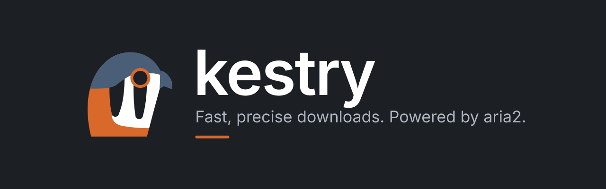

<p align="center">
  
</p>

# Kestry

English · [Español](README.es.md)

A self-hosted download manager for torrents, magnet links and direct links (HTTP/HTTPS/FTP). It runs on a home PC or server, uses [aria2](https://aria2.github.io/) as the download engine, and is managed from any browser with a live, responsive UI built on the *Kestrel* design system, which is part of this project.

- Paste a whole list of links (one per line) and add them in a click; drop `.torrent` files too.
- Several downloads at once, the rest queued; pause, resume, retry, cancel.
- Live progress, speed, ETA and peers over Server-Sent Events.
- Speed limits, concurrency, download folder, seeding and "shut down when finished".
- One process, one port. No database. No login: protect it with a tunnel or VPN (see [Remote access](#remote-access-and-security)).

- Available in English, Spanish, German and French. The language follows your browser and can be changed from the globe icon in the header (remembered in the browser).

## Install

### Docker (recommended)

```bash
cd docker
mkdir -p data downloads
sudo chown -R 1654:1654 data downloads   # the image runs as uid 1654; otherwise aria2 fails with permission denied
docker compose up -d --build
```

Open <http://localhost:8080>. The port is published on `127.0.0.1` only; to reach it from other devices on your network set `KESTRY_BIND` in `docker/.env` to the server's LAN IP (e.g. `192.168.1.50`) and open `http://192.168.1.50:8080`. There is no login, so anyone on that network can use it; never forward `8080` on your router. The image bundles aria2 and runs as a non-root user (use `user:` in the compose file to match the owner of the mounted folders). Forward `6881` TCP/UDP on your router for better BitTorrent speeds.

**Prebuilt image from Docker Hub** ([`davidartifacts/kestry`](https://hub.docker.com/r/davidartifacts/kestry), tags `X.Y.Z`, `X.Y`, `latest`; also `ghcr.io/artifacts-oss/kestry`), no clone or build needed:

```bash
mkdir -p kestry/data kestry/downloads && cd kestry
sudo chown -R 1654:1654 data downloads
docker run -d --name kestry --restart unless-stopped \
  -p 127.0.0.1:8080:8080 -p 6881:6881/tcp -p 6881:6881/udp \
  -v "$PWD/data:/data" -v "$PWD/downloads:/downloads" \
  davidartifacts/kestry:latest
```

On Windows (Docker Desktop, PowerShell) no `chown` is needed:

```powershell
mkdir kestry\data, kestry\downloads; cd kestry
docker run -d --name kestry --restart unless-stopped `
  -p 127.0.0.1:8080:8080 -p 6881:6881/tcp -p 6881:6881/udp `
  -v "${PWD}\data:/data" -v "${PWD}\downloads:/downloads" `
  davidartifacts/kestry:latest
```

Both commands publish the UI on this machine only. To reach it from other devices on your network, publish it on the server's LAN IP instead: `-p 192.168.1.50:8080:8080`, then open `http://192.168.1.50:8080` (same warning as above: no login, never forward `8080` on your router).

With Compose, in `docker/docker-compose.yml` delete the `build:` block and set `image: davidartifacts/kestry:latest`, then `docker compose up -d`. To update: `docker compose pull && docker compose up -d` (with `docker run`: pull, then remove and recreate the container; `data/` keeps settings and the queue).

### Binary (Windows / Linux)

Download the zip for your platform from the releases page (or build it with `scripts/publish.sh`), extract it, and run `Kestry.Server` (`Kestry.Server.exe` on Windows). Keep `wwwroot/` and `appsettings.json` next to the executable. Then open <http://127.0.0.1:8080>. It listens on loopback only; for other devices on your network set `Urls` to the server's LAN IP (`Urls=http://192.168.1.50:8080` as an environment variable or in `appsettings.json`).

aria2 is **never bundled**:

| Platform | What happens |
|----------|--------------|
| Windows | If `aria2c.exe` is not found, Kestry downloads the pinned official release, verifies its SHA-256 and extracts it to `data/aria2/` (the UI shows "Installing aria2…"). With no internet or a wrong hash nothing is run; copy `aria2c.exe` to `data/aria2/` by hand or set `Aria2:Path`. |
| Linux | Install it with your package manager (`apt install aria2`, `dnf install aria2`…) or set `Aria2:Path`. Kestry reports "aria2 is not responding" with instructions until it is found. |

Search order: `Aria2:Path` → `PATH` → `<DataDir>/aria2/`.

**As a service** (the app detects the service manager):

- Windows, from an administrator PowerShell (`sc.exe`, since `sc` is an alias of `Set-Content` there). The service runs as LocalSystem, whose default download folder is inside `C:\Windows\System32\config\systemprofile`, so set `Kestry:AllowedRoots` in `appsettings.json` first (e.g. `["D:\\Downloads"]`):

  ```powershell
  sc.exe create Kestry binPath= "C:\Kestry\Kestry.Server.exe" start= auto
  sc.exe start Kestry
  ```

- Linux (systemd), with the zip extracted to `/opt/kestry` and [`deploy/kestry.service`](deploy/kestry.service) from this repository. The `kestry` user needs write access to `/opt/kestry` (`data/`) and a home directory (downloads default to `~/Downloads/Kestry`):

  ```bash
  sudo useradd --system --create-home --home-dir /var/lib/kestry --shell /usr/sbin/nologin kestry
  sudo chown -R kestry:kestry /opt/kestry
  sudo cp kestry.service /etc/systemd/system/
  sudo systemctl daemon-reload && sudo systemctl enable --now kestry
  ```

### From source

Requires .NET SDK 10 and Node 22.

```bash
cd src/kestry-web && npm ci && npm run build     # writes src/Kestry.Server/wwwroot
cd ../.. && dotnet run --project src/Kestry.Server
```

## Configuration

`appsettings.json` next to the executable, or environment variables (`Kestry__AllowedRoots__0=/downloads`, `Aria2__Port=6800`…).

| Key | Default | Meaning |
|-----|---------|---------|
| `Urls` | `http://127.0.0.1:8080` | Where Kestry listens. Only loopback by default; the Docker image uses `http://+:8080` (and the compose file publishes it on `127.0.0.1`). Set it with the `Urls` variable, not `ASPNETCORE_URLS`. |
| `Kestry:DataDir` | `./data` (next to the executable) | `settings.json`, `aria2.session`, `history.json` (finished downloads), downloaded aria2 binary |
| `Kestry:AllowedRoots` | `[]` (= `~/Downloads/Kestry`) | The only folders the download folder may be in, and where files may be deleted. Docker sets `/downloads`. Not editable from the UI. |
| `Kestry:AllowShutdown` | `true` | Set `false` to disable "shut down when finished" entirely |
| `Kestry:AllowedOrigins` | `[]` | Extra origins/hosts accepted, e.g. your tunnel's `https://kestry.example.com` |
| `Aria2:Path` | `null` | Explicit `aria2c` path |
| `Aria2:Port` | `6800` | aria2 RPC port (loopback only, random secret each start) |
| `Aria2:BtPort` | `6881` | BitTorrent + DHT port (TCP/UDP) |
| `Aria2:ExtraArgs` | `[]` | Extra aria2 command-line arguments |

User settings (concurrency 1–20, speed limits, download folder, seeding, shut-down) are edited in the UI (gear icon) and stored in `settings.json`. They apply to running downloads without restarting aria2. The folder only affects new downloads. The theme (light/dark/system) is stored in the browser.

## Usage

- **Add**: click *Add*, or just press `Ctrl+V` anywhere on the page outside a text field. Separate links with new lines, spaces or commas; lines starting with `#` are ignored. A live summary shows valid, duplicate and invalid links before anything is added. Duplicates are detected within the batch and against existing downloads (by URL or torrent info-hash).
- **Rows**: downloading → pause/cancel · paused → resume/cancel · queued → cancel · failed → retry/remove · completed → copy path/remove. *Cancel* deletes partial files; *Remove* optionally deletes the files. Retrying a torrent re-adds it from its magnet.
- **Shut down when finished**: arms when the queue is empty and at least one download completed in this session (paused downloads and seeding torrents count as pending). A 60 s countdown is shown in every open browser and can be cancelled. On Linux the service user needs permission to power off: install `deploy/50-kestry-poweroff.rules` as a polkit rule (adjust the user). It is unavailable in containers and when `AllowShutdown` is `false`.

## Remote access and security

Kestry has **no authentication on purpose**; protect it at the network layer. By default it listens on loopback only, and aria2 is never exposed (loopback + random RPC secret). Additionally, every `/api` request must come from a loopback/IP/`AllowedOrigins` host (stops DNS rebinding), and mutating requests from a browser must carry the page's own `Origin` or an allowed one (stops cross-site requests). Folder changes and file deletion are confined to `AllowedRoots`; request bodies are size-limited.

### Cloudflare Tunnel + Access

1. In Cloudflare Zero Trust create a tunnel and a public hostname `kestry.example.com` → service `http://kestry:8080` (use a subdomain, not a sub-path). Copy the tunnel token.
2. Add an **Access** application for that hostname with a policy (email OTP or your identity provider). Only allowed users reach Kestry; nothing is opened on your router.
3. In `docker/.env`: `KESTRY_PUBLIC_URL=https://kestry.example.com` and `CLOUDFLARE_TUNNEL_TOKEN=…`, then `docker compose --profile tunnel up -d`.
4. Check that live updates are not buffered: open the site, add a download and confirm progress updates every second (the stream is sent with `Cache-Control: no-cache` and `X-Accel-Buffering: no`).

### Tailscale / WireGuard

Bind Kestry to the private interface (`Urls=http://100.x.y.z:8080`, or publish the Docker port on that address) and browse to it from your devices. IP addresses are accepted without extra configuration; for a MagicDNS name add `Kestry__AllowedOrigins__0=http://my-host:8080`.

## Development

```bash
dotnet test                              # backend (real-aria2 smoke tests are skipped without aria2c)
cd src/kestry-web && npm test            # frontend
npm run typecheck && npm run build

# live development: backend + Vite dev server (Vite rewrites Host, so allow its origin)
Kestry__AllowedOrigins__0=http://localhost:5173 dotnet run --project src/Kestry.Server
cd src/kestry-web && npm run dev         # http://localhost:5173
```

See [AGENTS.md](AGENTS.md) for the architecture, conventions and pitfalls. CI (`.github/workflows/ci.yml`) runs both test suites, the frontend build, a Docker build and the self-contained publish for `win-x64`, `linux-x64` and `linux-arm64`; publishing a GitHub release with a `vX.Y.Z` tag pushes the multi-arch image to GHCR and Docker Hub (`<DOCKER_USERNAME>/kestry`, tags `X.Y.Z`, `X.Y`, `latest`) and attaches the zips to the release, stamping the tag as the app version (csproj `<Version>` is only the local default) (`release.yml`; needs the `DOCKER_USERNAME` and `DOCKER_PASSWORD` organization secrets, as in daylog; the password is a Docker Hub access token with read & write).

### API

| Method | Path | Description |
|--------|------|-------------|
| `GET` | `/api/downloads` | Snapshot (same payload as the SSE event) |
| `POST` | `/api/downloads/links` · `/links/preview` | `{ text, subfolder?, paused? }` add / dry-run a pasted list |
| `POST` | `/api/downloads/torrents` | multipart `.torrent` files (`?subfolder=&paused=`) |
| `POST` | `/api/downloads/{gid}/pause` · `/resume` · `/retry` | Per-download actions |
| `DELETE` | `/api/downloads/{gid}?deleteFiles=` | Cancel or remove |
| `POST` | `/api/downloads/pause-all` · `/resume-all` · `/purge` | Global actions |
| `GET` `PUT` | `/api/settings` | Read / save settings (400 with per-field errors) |
| `POST` | `/api/shutdown/cancel` | Cancel the shutdown countdown |
| `GET` | `/api/system` | Versions and whether shutdown is available |
| `GET` | `/api/events` | SSE, one `snapshot` event per second |
| `GET` | `/health` | Health including aria2 state |

Errors are JSON `{ "code": "links.tooMany", "error": "English text", "params": { "max": 2000 } }` (settings add `errors` keyed by field). Clients should rely on `code`; the web UI translates it.

## Limits (v1)

No users/permissions, torrent search/RSS, streaming, `sftp://` links, queue reordering, bulk selection or per-download detail panel. The ideas for later are listed in `docs/PLAN-en.md` §15.

## Advice

This project is mostly designed and coded by AI agents. The generated code and its behavior are reviewed carefully by a human and by dedicated code-quality agents before they are merged.

AI-generated pull requests are welcome, provided the human who created them has reviewed the code and verified its behavior **before** opening the PR. Unreviewed AI output will not be merged.

## License

[MIT](LICENSE). The Kestrel design system (tokens and components in `design/kestrel/`, implemented in `src/kestry-web/src/components/ui/` and `src/kestry-web/src/styles/tokens.css`) is included in this repository and free to use under the same terms.
